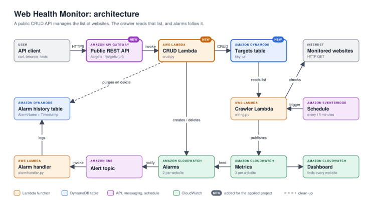

# Website Monitoring Dashboard through AWS
AWS CDK application that monitors the health of a list of websites wit ha public CRUD API for managing that list. Every change deployed goes through a four stage CI/CD pipeline, with automated tests at each stage and also manual approval required.

This project was split into two parts. The **Web Health project** added a crawler Lambda that will check each website every 15 minutes, CloudWatch metrics, alarms and a adashboard, SNS notifications, alarm history table, and a CodePipeline with Alpha, Beta, Gamma and Prod stages. The **Applied Project** moves the list of websites which originally were in a JSON file into DynamoDB, added a public REST API to create, read, update, and delete entries, and added more tests in every pipeline stage.

# Metrics / Dashboard
- Availability: 1 = Online, 0 = Offline
- StatusCode: HTTP status code returned
- Response Time (ms): how long the site takes to respond

## Architecture


Components marked NEW were added for the applied project. The API Gateway, CRUD Lambda and the targets table.

- **Public REST API (API Gateway)** receives the HTTP requests for `\targets` and passes them to CRUD Lambda/
- **CRUD Lambda (`crud.py`)** creates, reads, updates, and deletes targets, and creates and deletes each targets alarms.
- **CodeDeploy** rolls back to version of CRUD Lambda if the API starts to return server errrors.
- **Targets table(DynamoDB)** holds the list of websites to monitor with `url` as the partition key.
- **Schedule (EventBridge)** triggers the crawler every 15 minutes.
- **Crawler Lambda (`wiring.py)** reads the targets table, checks each website and publishes the website to CloudWatch/
- **CloudWatch** stores three metrics per website, holds two alarms per website and holds a dashboard.
- **Alarm handler (`alarmhandler.py`)** is subscrbed to the topic and writes each alarm state change to the alarm history table.
- **Alarm history table (DynamoDB)** uses `AlarmName` as partition key and `Timestamp` as the sort key.

## How it works

### Adding a website

1. A user sends a `POST /targets` with `{"url": "https://example.com/"}`.
2. API Gateway applies the CRUD Lambda.
3. The Lambda validates the URL and writes it to the targets table. The write is conditional, so if a URL that already exists you will get a `409 Conflict` status.
4. The Lambda creates two CloudWatch alarms for that URL.
5. On the next run within 15 minutes the crawler will scan targets table, find new URL and start checking it.

No redeployment is needed. Before the applied project adding new websites would be manually editing `websites.json` and running the whole pipeline again

No redeployment is needed. Before the applied project, adding a website meant editing `websites.json` and running the whole pipeline.


### Monitoring a website

Every 15 minutes EventBridge will trigger the crawler. For each URL in the targets table it will set a GET request and publish those metrics to `WebsiteMonitoring`. `ResponseTime` is in milliseconds, `StatusCode` (0 if the request failed), and `Availability` (1 if the site responds and 0 if not).

Each website has two alarms named afte rthe stack and the website. The reponseTime alarm fires when the average response time is abvoe the threshhold for two consecutive periods. The Availability alarm fires when availability drops below 1. When an alarm changes fires, CloudWatch will notify the SNS topic, and the alarm handler records the change in the alarm history table.

### Removing a website

`DELETE /targets/{url}`. It removes the item from the targets table, deletes both of the website's alarms, and deletes every row those alarms wrote to the alarm history table.

## The target list API

Reference for all examples is in [API](API.md)

- `GET /targets` lists every target.
- `POST /targets` adds a target and creates its alarms.
- `GET /targets/{url}` reads one target and the current state of its alarms.
- `PUT /targets/{url}` replaces a target's URL, replacing its alarms too.
- `DELETE /targets/{url}` deletes a target, its alarms and its alarm history.

The API is RESTful so the target list is a resource with its own URL, the HTTP method states the operation, status codes report the outcome, and each request is stateless, all state is held in DynamoDB

```powershell
$api = "https://<api-id>.execute-api.ap-southeast-2.amazonaws.com/v1/targets"

# List
Invoke-RestMethod $api

# Add
Invoke-RestMethod $api -Method Post -ContentType "application/json" -Body '{"url": "https://example.com/"}'

# Delete
Invoke-RestMethod "$api/$([uri]::EscapeDataString('https://example.com/'))" -Method Delete
```


## Design Decisions

### One Lambda for all CRUD operations

API Gateway sends every request to one CRUD Lambda. This keeps validation, alarm naming, and error handling all in one place.

### The CRUD Lambda owns the alarms

In the Web Health project, the CDK stack created the alarms in a loop over `websites.json`, so this means it was fixed at deploy time. Once websites can be added and removed at runtime through the API the alarm loop was removed from the stack and the CRUD Lambda calls `put_metric_alarm` on `POST` AND `delete_alarms` on `DELETE`.

The stack and Lambda can't both manage the same alarms as it means they would overwrite each other.

### Seeding and clean up

Because CloudFormation no longer creates the alarms, it can't set up on deploy or remove on teardown. The stack uses a `AwsCustomResource` to apply the CRUD Lambda at deployment and teardown. `seed_targets` adds the three websites in the `websites.json` to the table along with their alarms. When the stack is deleted, `purge_all_alarms` deletes every alarm with the name that starts with that stacks name.

`websites.json` is now just the starting list for a new stage, after that, the target table is where the data will be taken from.


### Least-privilege permissions

The CRUD Lambda can only create and delete alarms whose names start with its own stack's name, such as `Beta-EricStack-*`, so one stage can't change another stage's alarms. The crawler has read-only access to the targets table.

### A dashboard that finds every website

The dashboard used to build three graphs per website from `websites.json`, so a website added through the API never appeared. It now uses CloudWatch `SEARCH` expressions, which show every website that has the metric, including ones added at runtime.

## Automated Rollback

The new version of CRUD Lambda is never switched on for everyone all at once. The API Gateway will call the Lambda through an alias called `live`, which points to a specific version. AWS CodeDeploy controls which version the alias points to.

When a deployment makes changes to the CRUD Lambda:
1. CodeDeploy will send 10% of API Traffic to new version for 5 minutes and the rest to previous version
2. A CloudWatch alarm wtaches the API's error metric and covers both handled failure including 500 and 502 errors
3. If the alarm fires in those 5 minutes CodeDeploy will move traffic to previous version. If CloudFormation update fails and rolls back the pipeline will stop at that stage.

Rollback alarm is called Rollback-<stack name>Api5xx.


## CI/CD pipeline

Every push to `main` starts the pipeline. Each stage deploys a complete, separate copy of the system, with its own tables, Lambdas and API, and a change must pass the stage's tests before being deployed

1. **Alpha** runs the unit tests before deploying, then deploys.
2. **Beta** deploys, then runs integration tests against its real resources. Promotion needs the manual approval `PromoteToGamma`.
3. **Gamma** deploys, then runs functional tests, including a full CRUD cycle through its public API. Promotion needs the manual approval `PromoteToProd`.
4. **Prod** deploys.

## Testing

**Unit tests** run in Alpha against nothing deployed. The stack is created in memory and checked as a CloudFormation template (`tests/unit/test_eric_stack.py`, 13 tests). The CRUD Lambda runs with its AWS calls replaced by mocks (`tests/unit/test_crud.py`, 4 tests).

**Integration tests** run in Beta against Beta's real Lambdas and DynamoDB tables (`tests/integration/test_integration.py`, 5 tests, and `tests/integration/test_crud_integration.py`, 2 tests). A real row is written to the real DynamoDB and deleted after success

**Functional tests** run in Gamma. They test the Lambda handlers with mocked AWS (`tests/functional/test_functional.py`, 8 tests) and the real public API (`tests/functional/test_crud_api.py`, 1 test).

```
cd eric
python -m pytest tests -v
```

## What the pipeline catches/caught

In the first deployment, the applied project failed in Beta. Four integration tests reported that the crawler Lambda gave an unhandled exception. The `wiring.py` uses `os.environ` but had forgot to import `os`.

## Deploying and running

You need a AWS account with the CDK region in `ap-southeast-2`, a GitHub personal access token stored in Secrets Manager as `github-token`, Python 3.13, Node.js and AWS CDK CLI.

Set up:

```
git clone <repository-url>
cd eric
python -m venv .venv
.venv\Scripts\Activate.ps1
python -m pip install -r requirements.txt
cdk bootstrap
```

Deploy the pipeline and push to `main`

```
cdk deploy PipelineStack
```

Once tests have passed approve `PromoteToGamma` and `PromoteToProd`. Eah stages API URL is in the CloudFormation under the stages stack.
 
 The target list and alarm history can be viewed in DynamoDB under Tables, the alarms in CloudWatch under Alarms, and metrics in CloudWatch under Dashboards.

 To tear down the architecture `cdk destroy`. Note though that it only removes the pipeline, the stage stacks are deployed seperately.

 ```
cdk destroy PipelineStack
aws cloudformation delete-stack --stack-name Alpha-EricStack --region ap-southeast-2
aws cloudformation delete-stack --stack-name Beta-EricStack --region ap-southeast-2
aws cloudformation delete-stack --stack-name Gamma-EricStack --region ap-southeast-2
aws cloudformation delete-stack --stack-name Prod-EricStack --region ap-southeast-2
```


